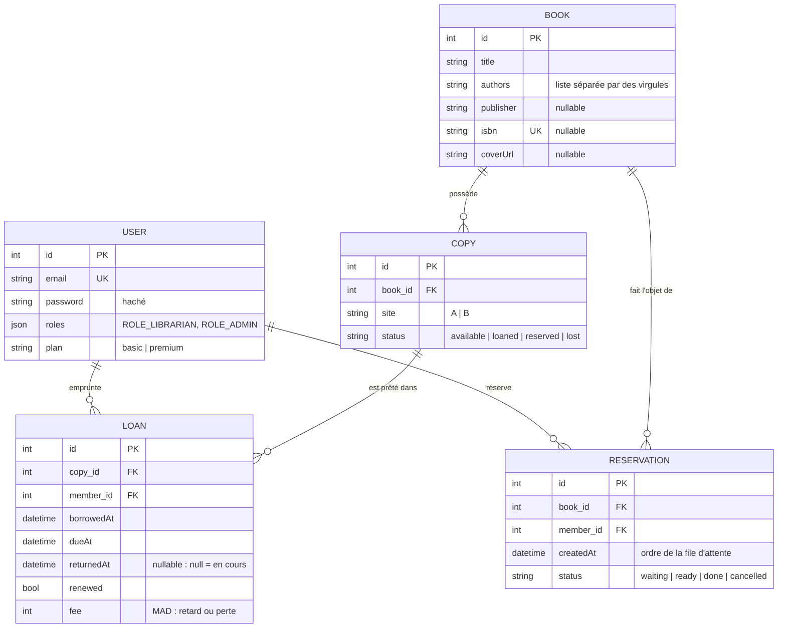

# Modèle de données

## Choix

- **Adhérent = `User`** : un seul compte porte l'identité, les rôles et la formule (`plan`). Pas de table `Member` à synchroniser.
- **Formules d'abonnement = enum PHP `Plan`** (`basic` : 3 prêts / 14 jours, `premium` : 6 prêts / 28 jours). Les limites sont du code, pas des données : pas de table à administrer pour deux valeurs.
- **Édition = `Book`**, identifiée par son ISBN (unique). Voir `DECISIONS.md`.
- **Exemplaire (`Copy`)** : c'est l'objet physique, rattaché à un site (`A` ou `B`). Le statut `reserved` signifie « retourné et mis de côté pour le premier de la file ».
- **File d'attente** : pas de colonne de position. L'ordre est celui de `createdAt` (puis `id`), donc rien à renuméroter.
- **Prêt en cours** : `returnedAt IS NULL`. Les frais (`fee`) sont figés au retour ou à la déclaration de perte.
- **Intégrité** : clés étrangères `NOT NULL`, `email` et `isbn` uniques, verrou pessimiste sur l'exemplaire et sur l'adhérent à l'emprunt (voir `DECISIONS.md`).
